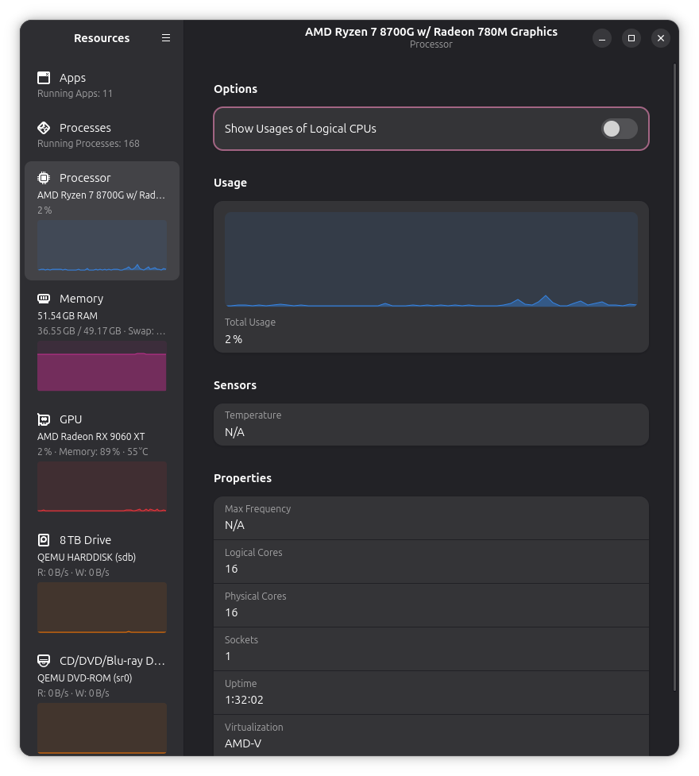
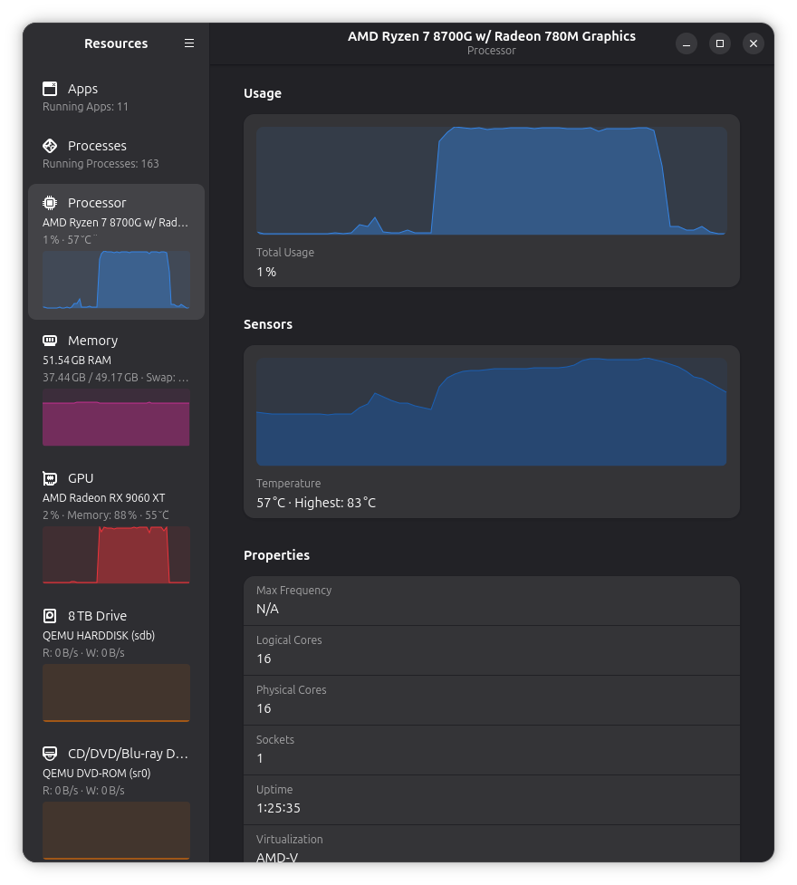

# hwmon-virt

Share your Proxmox VE host's temperatures with its Linux virtual machines.

Virtual machines usually cannot read the physical computer's CPU temperature.
hwmon-virt makes selected host temperature sensors available inside the VM,
where tools such as `sensors` and Resources can display them.

You can share CPU, GPU, or other temperature sensors that Linux can read on the
host. The readings describe the physical hardware shared by your VMs.

Proxmox VE is the supported deployment target. The host installation and removal
scripts use Proxmox's VM management tools.

Resources inside a Proxmox VM, before and after setup:

| Before: temperature unavailable | After: temperature and history visible |
| :---: | :---: |
|  |  |

## Requirements

- A Proxmox VE host and a Linux guest.
- Administrator access to both machines.
- Python 3.9 or newer and systemd on both machines.
- curl or wget, and tar, on both machines.
- `lm-sensors` in the guest for the `sensors` command.
- DKMS, a C compiler, make, and matching kernel headers in the guest.
- A working temperature sensor on the host.

The installers check dependencies but do not install missing system packages.
See [tested configurations](docs/testing.md#local-validation) for compatibility details.

## Installation

The **host** is the physical computer running Proxmox. The **guest** is the
virtual machine where you want to see temperatures. These examples use VM
**101**; replace it with your VM's ID.

### 1. Download the release on both machines

Run on the host and again in the guest. With curl:

```sh
curl -fL -o hwmon-virt-0.1.0.tar.gz \
  https://github.com/wmeddie/hwmon-virt/releases/download/v0.1.0/hwmon-virt-0.1.0.tar.gz
```

Or with wget:

```sh
wget -O hwmon-virt-0.1.0.tar.gz \
  https://github.com/wmeddie/hwmon-virt/releases/download/v0.1.0/hwmon-virt-0.1.0.tar.gz
```

Then extract the archive and enter its directory:

```sh
tar -xzf hwmon-virt-0.1.0.tar.gz
cd hwmon-virt-0.1.0
```

The [release page](https://github.com/wmeddie/hwmon-virt/releases) includes source
archives and SHA-256 checksums. The guest installer builds the driver for your
running kernel.

Run the following commands from that directory. Host installation commands
should run as root; guest installation commands use `sudo`.

### 2. Choose a sensor on the host

List the available temperature sensors:

```sh
python3 hwmon_virt.py list
```

Choose the sensor you want to share and pass its name to the installer. For
example, if the list includes `coretemp:Package id 0`:

```sh
./install-host.sh --vmid 101 --sensor 'coretemp:Package id 0'
```

This configures temperature sharing for the selected VM and starts the host
service. To share more than one sensor, see [additional sensors](docs/manual-install.md#parameters-and-additional-channels).

### 3. Install in the guest

```sh
sudo ./install-guest.sh
```

This installs the guest driver and service. You can add `--dry-run` to either
installer to preview its changes. Guests using Secure Boot may need to enroll
a module-signing key through their distribution's DKMS setup.

### 4. Stop and start the VM

The new connection becomes available after a full VM stop/start. Run these on
the **Proxmox host**; shutting down will disconnect sessions in the guest:

```sh
qm shutdown 101 --timeout 120
qm status 101   # wait until the VM is stopped before continuing
qm start 101
```

A reboot from inside the guest does not activate the new connection.

### 5. Check the temperature

In the guest, run:

```sh
/usr/bin/sensors
```

Look for a temperature labeled `Host CPU`. Open your monitoring application to
check its display. If Resources was already open and still shows N/A, restart it.

## Upgrading

Download and extract the new release on **both machines** using the
[download steps above](#1-download-the-release-on-both-machines). Run the
following commands from the newly extracted directory. Installed configuration
is kept separately from the downloaded files.

On the **host**, rerun the installer without `--sensor` to keep your existing
sensor selection:

```sh
./install-host.sh --vmid 101
```

In the **guest**:

```sh
sudo ./install-guest.sh
```

After installation succeeds, load the updated guest driver:

```sh
sudo systemctl stop hwmon-virt-guest &&
sudo modprobe -r hwmon_virt &&
sudo systemctl start hwmon-virt-guest
```

A guest reboot is an alternative to these three commands. If unloading reports
that the module is in use, start the service again and reboot the guest when
convenient.

An upgrade with an existing connection does not require a Proxmox host reboot
or a VM stop/start. Temperature readings are briefly unavailable during the update.

## Uninstalling

In the **guest**, preview removal, then run it:

```sh
sudo ./uninstall-guest.sh --dry-run
sudo ./uninstall-guest.sh
```

On the **host**, remove sharing for your VM:

```sh
./uninstall-host.sh --vmid 101 --dry-run
./uninstall-host.sh --vmid 101
```

Configuration is kept for reinstallation. Add `--purge` to remove it too.
The host script leaves other VMs alone and never stops or starts a VM.
A full VM stop/start removes the disconnected channel; use `--keep-channel`
if you plan to reinstall and want to keep that connection available.

See [uninstall details](docs/uninstall.md) for what is removed and how to handle errors.

## Troubleshooting

If the guest has no temperature reading, check its service:

```sh
systemctl status hwmon-virt-guest
journalctl -u hwmon-virt-guest -n 50
```

On the host, check the service for your VM:

```sh
systemctl status hwmon-virt-host@101
journalctl -u hwmon-virt-host@101 -n 50
```

If `sensors` shows the temperature but a monitoring app does not, restart the
app. Applications differ in how they choose a CPU sensor; see
[monitoring application compatibility](docs/manual-install.md#monitoring-applications).

See the manual for [additional troubleshooting](docs/manual-install.md#troubleshooting).

## More information

- [Manual installation and configuration](docs/manual-install.md)
- [Building, testing, and compatibility](docs/testing.md)
- [How it works](docs/protocol.md)
- [Contributing](CONTRIBUTING.md)
- [Changelog](CHANGELOG.md)

## License

GNU General Public License version 2 only (GPL-2.0-only).
See [LICENSE](LICENSE) and [COPYING](COPYING).
